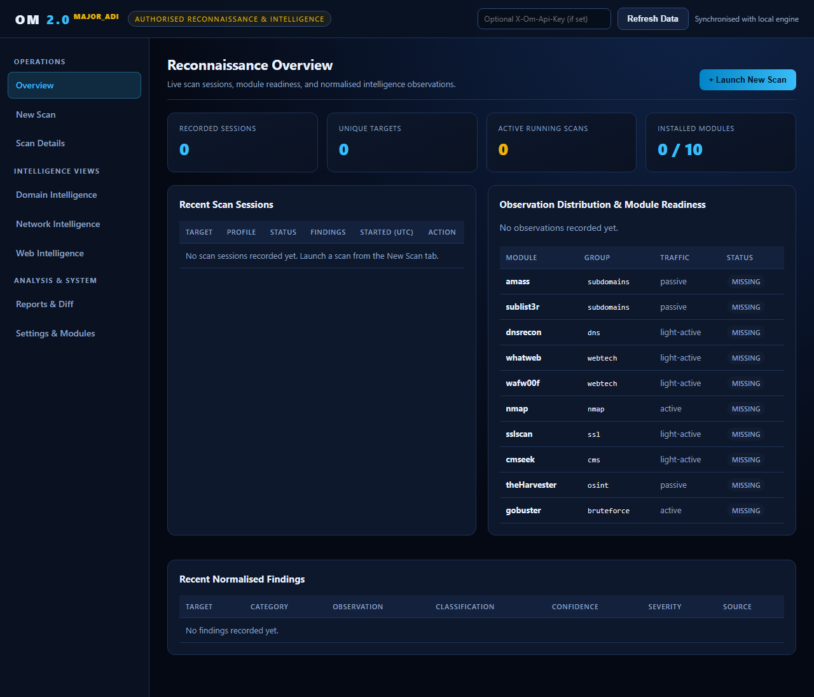
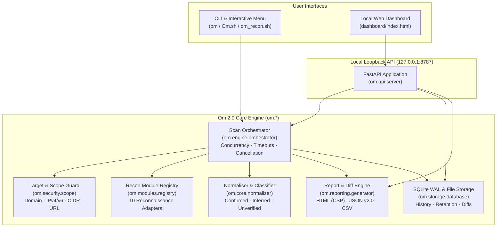

# OM 2.0 — Automated Reconnaissance & Intelligence Platform

**Developer Identity:** Major_ADI  
**Repository:** [https://github.com/adiz777/Om](https://github.com/adiz777/Om)  
**Licence:** GNU General Public License v3.0 (`GPL-3.0`)

---

## 1. Project Overview

**Om 2.0** is a modular automated reconnaissance and intelligence-gathering platform designed for authorised security assessments, penetration-testing preparation, cybersecurity education, and defensive surface monitoring.

Evolving from the original Bash-based `Om.sh` toolkit, **Om 2.0** retains all 10 classic reconnaissance integrations while introducing a clean Python engine, strict target and scope validation, concurrent module execution, evidence-graded output normalisation, SQLite scan history, session diffing, and a local 8-view web dashboard.

---

## 2. Features

- **10 Integrated Reconnaissance Modules:** Unified adapters for `nmap`, `amass`, `sublist3r`, `whatweb`, `dnsrecon`, `wafw00f`, `sslscan`, `theHarvester`, `gobuster`, and `cmseek`.
- **Non-Destructive Dependency Diagnostics (`--check-tools`):** Inspects installed binaries, probes versions, and prints `apt` / `pipx` / `go` installation hints without ever running `sudo apt install` automatically.
- **Profile-Driven & Concurrent Orchestration (`low`, `medium`, `high`):** Runs independent modules concurrently (`--concurrency 1..8`) with per-module timeouts (`--timeout`), mid-scan cancellation, and partial result preservation.
- **Target & Scope Enforcement (`om.security.scope`):** Validates domains, subdomains, IPv4/IPv6 addresses, CIDR blocks, and HTTP(S) URLs. Blocks shell metacharacters, leading-dash argument injection, path traversal, and loopback/link-local/metadata/private ranges unless explicitly scoped (`--scope`).
- **Evidence-Graded Normalisation & Deduplication:** Separates `raw_observation`, `normalised_finding`, `inferred_finding`, and `confirmed_issue` across `confirmed`, `inferred`, and `unverified` confidence tiers while merging multi-tool provenance.
- **Professional Local Web Dashboard (`--dashboard`):** Loopback-bound FastAPI backend (`127.0.0.1:8787`) serving an 8-view dark cybersecurity UI (*Overview*, *New Scan*, *Scan Details*, *Domain Intelligence*, *Network Intelligence*, *Web Intelligence*, *Reports & Diff*, and *Settings & Modules*).
- **Self-Contained Reports & Session Comparison:** Exports dark/print-friendly HTML reports (hardened with `html.escape` and strict `Content-Security-Policy`), versioned JSON (`Schema v2.0`), and CSV files, plus `--compare` diffing between any two scan sessions.
- **Classic Interactive Menu Preserved:** Running `./Om.sh` or `om --interactive` launches the familiar numbered menu (`1`–`11`) backed by the new safe orchestration engine. The original legacy script is preserved verbatim at [`scripts/legacy/Om.sh`](scripts/legacy/Om.sh).

---

## 3. Local Web Dashboard Screenshot



---

## 4. Architecture Diagram



See [`docs/ARCHITECTURE.md`](docs/ARCHITECTURE.md) for detailed component design.

---

## 5. Installation Instructions (Kali Linux / Debian / Ubuntu)

### 5.1 Python Virtual Environment Installation (Recommended)

```bash
git clone https://github.com/adiz777/Om.git
cd Om

python3 -m venv .venv
source .venv/bin/activate

pip install --upgrade pip
pip install -e ".[dev]"
chmod +x Om.sh om_recon.sh
```

### 5.2 Installing Optional External Reconnaissance Binaries

Om 2.0 works out of the box even when optional external binaries are absent (missing tools are cleanly marked `skipped_missing`). On Kali Linux or Debian/Ubuntu, install the external tools you need:

```bash
sudo apt update
sudo apt install -y nmap amass sublist3r whatweb dnsrecon wafw00f sslscan theharvester gobuster cmseek
```

Verify detected tools and versions at any time:

```bash
om --check-tools
# Or output machine-readable JSON:
om --check-tools-json
```

### 5.3 Platform Support Notes

- **Kali Linux / Parrot OS / Ubuntu / Debian:** Primary supported environments where all 10 external tools are packaged.
- **macOS / Windows:** The Om 2.0 Python engine, CLI, SQLite storage, report generator, test suite, and local web dashboard run natively on Windows, macOS, and Linux. External Linux-specific utilities (`whatweb`, `dnsrecon`, `cmseek`, etc.) are optional and reported as `skipped_missing` if not installed in `PATH` or configured in `tool_paths`.

---

## 6. Quick-Start Examples

### Check installed reconnaissance tools

```bash
./Om.sh --check-tools
```

### Run a conservative passive/lightweight scan (`low` profile)

```bash
./Om.sh --target example.com --profile low --output ./om_reports
```

### Run a scoped `medium` scan with explicit active authorisation

```bash
./Om.sh --target example.com \
  --profile medium \
  --scope "example.com,*.example.com" \
  --authorize-active \
  --concurrency 3 \
  --output ./om_reports
```

### Run specific modules only

```bash
./Om.sh --target example.com --modules subdomains,dns,ssl --no-zip
```

### Launch the Local Web Dashboard

```bash
./Om.sh --dashboard --host 127.0.0.1 --port 8787
```

Then open `http://127.0.0.1:8787` in your browser.

### View scan history and compare two sessions

```bash
./Om.sh --history --output ./om_reports
./Om.sh --compare ./om_reports/session_old/report.json ./om_reports/session_new/report.json
```

### Launch classic interactive menu mode

```bash
./Om.sh --interactive
```

---

## 7. Supported Reconnaissance Modules

| Tool | Module Group | Supported Targets | Traffic Mode | Requires `--authorize-active` | Purpose & Limitations |
|---|---|---|---|---|---|
| **Amass** (`amass`) | `subdomains` | `domain` | `passive` (`low`/`medium`), `active` (`high`) | No | OWASP Amass subdomain enumeration. Discovered names are `unverified` until resolved. |
| **Sublist3r** (`sublist3r`) | `subdomains` | `domain` | `passive` | No | OSINT subdomain discovery across public search engines. |
| **DNSRecon** (`dnsrecon`) | `dns` | `domain` | `light-active` | No | Queries `A`, `AAAA`, `MX`, `NS`, `TXT`, `SOA`, `SRV` records and checks `AXFR` zone transfer in `high` profile. |
| **WhatWeb** (`whatweb`) | `webtech` | `domain`, `ip` | `light-active` | No | Identifies web server banners, frameworks, and HTTP status codes (`-a=1` in low/medium, `-a=3` in high). |
| **WafW00f** (`wafw00f`) | `webtech` | `domain`, `ip` | `light-active` | No | Web Application Firewall signature detection. |
| **Nmap** (`nmap`) | `nmap` | `domain`, `ip`, `cidr` | `active` | **Yes** | Port and service version discovery (`-sV --top-ports 100 -T3` in medium; `-sV -sC -T4 --top-ports 1000` in high). |
| **SSLScan** (`sslscan`) | `ssl` | `domain`, `ip` | `light-active` | No | Inspects TLS protocols (`SSLv2/v3`, `TLSv1.0–1.3`) and certificate subject/issuer/expiry metadata. |
| **CMSeeK** (`cmseek`) | `cms` | `domain`, `ip` | `light-active` | No | Detects CMS platforms and version indicators in non-interactive `--batch` mode. |
| **theHarvester** (`theHarvester`) | `osint` | `domain` | `passive` | No | Harvests public emails and hostnames from key-free public sources (`crtsh,urlscan,rapiddns`). |
| **Gobuster** (`gobuster`) | `bruteforce` | `domain`, `ip` | `active` | **Yes** | Rate-limited HTTP directory/file discovery using a validated local wordlist (`--wordlist`). |

---

## 8. Configuration Reference

Om 2.0 accepts a JSON configuration file via `--config` (see [`examples/om.config.example.json`](examples/om.config.example.json)) as well as environment variables:

| Field / JSON Key | CLI Flag | Env Variable | Default | Description |
|---|---|---|---|---|
| `profile` | `-p`, `--profile` | `OM_PROFILE` | `"low"` | Scan profile (`low`, `medium`, `high`). |
| `modules` | `-m`, `--modules` | — | Profile default | List of module groups or tool names to execute. |
| `scope` | `--scope` | `OM_SCOPE` | `[target]` | Authorised domains, `*.wildcards`, IPs, or CIDRs. |
| `authorize_active` | `--authorize-active` | `OM_AUTHORIZE_ACTIVE` | `false` | Required before running `nmap` or `gobuster`. |
| `timeout` | `--timeout` | `OM_TIMEOUT` | `90` (`low`), `180` (`medium`), `300` (`high`) | Per-module execution timeout in seconds (`5`–`3600`). |
| `concurrency` | `--concurrency` | `OM_CONCURRENCY` | `2` (`low`), `3` (`medium`), `4` (`high`) | Concurrent worker limit (`1`–`8`). |
| `rate_limit` | `--rate-limit` | `OM_RATE_LIMIT` | `5` / `15` / `25` | Max packets/threads for active scanners (`1`–`500`). |
| `output_dir` | `-o`, `--output` | `OM_OUTPUT_DIR` | `"om_reports"` | Output directory for session folders and reports. |
| `db_path` | `--db-path` | `OM_DB_PATH` | `"om_reports/om_history.db"` | SQLite database path for local scan history. |
| `wordlist` | `--wordlist` | — | `"/usr/share/wordlists/dirb/common.txt"` | Wordlist path for Gobuster. |
| `tool_paths` | — | — | `{}` | Optional custom binary paths per tool (`{"nmap": "/opt/nmap"}`). |
| `report_formats` | `--format` | — | `["html", "json", "csv"]` | Report formats generated at the end of a scan. |
| `archive_zip` | `--no-zip` (inverts) | — | `true` | Create a `.zip` bundle of the session directory. |

---

## 9. Example Report Output (Synthetic Data)

Every scan produces `report.json` (`Schema v2.0`), `Report.html`, and `findings.csv` inside `OM_Recon_<target>_<timestamp>_<id>/`. See [`examples/sample_report.json`](examples/sample_report.json) for a complete synthetic report:

```json
{
  "schema_version": "2.0",
  "tool_name": "Om",
  "tool_version": "2.0.0",
  "author": "Major_ADI",
  "session_id": "example.com_20261028T120000Z_a1b2c3",
  "status": "completed",
  "target": "example.com",
  "profile": "medium",
  "findings": [
    {
      "category": "subdomain",
      "value": "api.example.com",
      "classification": "normalised_finding",
      "confidence": "confirmed",
      "severity": "info",
      "source_tool": "amass, dnsrecon",
      "detail": "Resolved via DNS enumeration"
    },
    {
      "category": "tls",
      "value": "TLSv1.0   enabled",
      "classification": "confirmed_issue",
      "confidence": "confirmed",
      "severity": "medium",
      "source_tool": "sslscan",
      "detail": "Deprecated TLS/SSL protocol enabled",
      "remediation": "Disable SSLv2, SSLv3, TLSv1.0, and TLSv1.1; enforce TLSv1.2 and TLSv1.3 only."
    }
  ]
}
```

---

## 10. Testing, Development & Uninstall Instructions

### Run automated tests and linter

```bash
# Run all unit, integration, and FastAPI tests (no external network access required)
pytest -v

# Run Ruff static analysis & security checks
ruff check om tests
```

### Uninstall & Cleanup

To remove the virtual environment and local scan data cleanly:

```bash
deactivate 2>/dev/null || true
rm -rf .venv build dist *.egg-info om_reports
```

---

## 11. Security Model & Responsible Use

- **Authorised Targets Only:** Only scan domains, IP addresses, and CIDR ranges you own or have explicit written permission to test.
- **Shell-Free Execution:** All external tools run with `shell=False` and validated argument arrays.
- **Loopback Dashboard & CSRF Protection:** The dashboard binds to `127.0.0.1` by default, validates `Origin` headers on state-changing requests, and supports `OM_API_KEY` header authentication.

Read [`SECURITY.md`](SECURITY.md) for full details and vulnerability reporting guidelines.

---

## 12. Known Limitations

1. **External Binary Availability:** Om 2.0 orchestrates external reconnaissance binaries (`nmap`, `amass`, etc.) installed on the host OS; if a binary is not installed, Om skips that module (`skipped_missing`) rather than failing the scan.
2. **Point-in-Time Surface Observations:** Reconnaissance banners and passive OSINT records reflect point-in-time observations and do not prove CVE exploitability without manual verification.
3. **Single-Node Local Execution:** The SQLite database and FastAPI dashboard are designed for single-analyst local use on `127.0.0.1`, not multi-tenant public cloud hosting.

---

## 13. Roadmap

- [ ] Optional XML/JSON native output flag parsers for `nmap -oX` and `whatweb --log-json` alongside text parsing.
- [ ] Built-in passive DNS & Certificate Transparency (`crt.sh`) fallback module inside the core orchestrator when external subdomain binaries are absent.
- [ ] Optional SARIF export format for GitHub Code Scanning integration.

---

## 14. Contributing

Contributions are welcome! Please read [`CONTRIBUTING.md`](CONTRIBUTING.md) and [`docs/MODULE_DEVELOPMENT.md`](docs/MODULE_DEVELOPMENT.md) before submitting a pull request.

---

## 15. Licence

This project is licensed under the **GNU General Public License v3.0** — see the [`LICENSE`](LICENSE) file for full terms.

**Created & Maintained by:** **Major_ADI**
