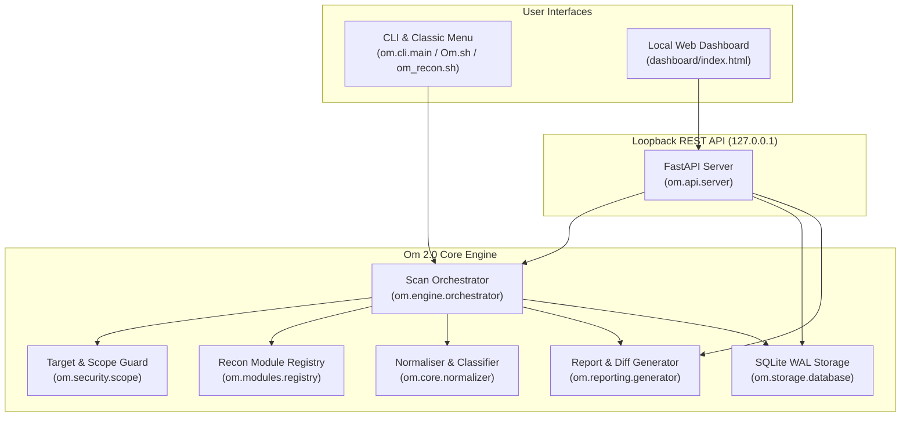

# Architecture — Om 2.0

**Project:** Om 2.0 — Automated Reconnaissance & Intelligence Platform  
**Author:** Major_ADI (`https://github.com/adiz777/Om`)  
**Licence:** GNU General Public License v3.0 (GPL-3.0)

## 1. Design Philosophy

Om 2.0 is a ground-up modular Python and FastAPI architecture that preserves all 10 reconnaissance tools from the original `Om.sh` toolkit while adding strict target validation, scope enforcement, concurrent execution, structured output normalisation, SQLite WAL persistence, and a local web dashboard.

## 2. Module Responsibilities

| Package | Responsibility |
|---|---|
| `om.models.schemas` | Immutable dataclasses (`TargetSpec`, `ModuleContract`, `Finding`, `ModuleExecutionResult`, `ScanProgress`, `ScanSession`). |
| `om.security.scope` | Validates domains, subdomains, IPv4/IPv6, CIDRs, and HTTP(S) URLs. Blocks shell metacharacters, leading-dash argument injection, path traversal (`..`), and loopback/link-local/metadata/private IPs unless explicitly scoped. |
| `om.core.config` | Defines `low`, `medium`, and `high` scanning profiles (`PROFILE_POLICIES`), timeouts, concurrency limits, and JSON/environment configuration loading. |
| `om.modules.registry` | Exposes the 10-tool `MODULE_REGISTRY` (`amass`, `sublist3r`, `dnsrecon`, `whatweb`, `wafw00f`, `nmap`, `sslscan`, `cmseek`, `theHarvester`, `gobuster`), non-destructive dependency detection, safe `subprocess.Popen(..., shell=False)` execution, timeout handling, and cancellation polling. |
| `om.core.normalizer` | Strips ANSI sequences, extracts structured findings from each tool's output, classifies observations (`raw_observation`, `normalised_finding`, `inferred_finding`, `confirmed_issue`), and deduplicates across tools while merging provenance. |
| `om.engine.orchestrator` | Coordinates concurrent module execution (`ThreadPoolExecutor`), enforces active authorisation gates, tracks live progress, supports mid-scan cancellation, and writes session outputs. |
| `om.storage.database` | Manages SQLite (`WAL` mode) schema migrations, session persistence, filtering/search, and configurable retention pruning. |
| `om.reporting.generator` | Generates self-contained dark/print-friendly HTML reports (`html.escape` + strict `Content-Security-Policy`), versioned JSON (`v2.0`), CSV exports, and session-to-session diffs. |
| `om.api.server` | Serves the local 8-view dashboard on `127.0.0.1` with CSRF origin validation and optional `OM_API_KEY` authentication. |
